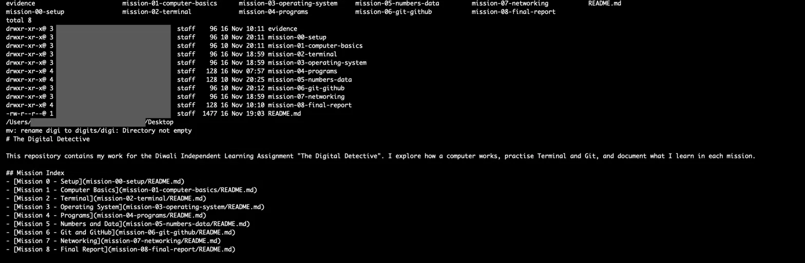

# Mission 2 - Terminal

# 1. Objective
My task was to practise basic Terminal commands for moving around, creating and copying files, to try flags and pipes, and to explain what a package manager is.

# 2. Basic Terminal operations
| Operation | Command | What it does | What I observed |
|---|---|---|---|
| Current-directory display | pwd | prints the full path of the current directory | Gives the full path of in which diretory I am |
| Directory listing | ls | shows all files and folders | I saw all the files and floders in my current directory |
| Detailed listing | ls -l | shows permissions,sizes and dates | I saw the permissions of all files |
| Change directory | cd .. | Moves to the parent directory | changes the directory to previous one |
| Create directory | mkdir demo-folder | Creates a new folder | Makes the empty folder |
| Create empty file | touch demo-folder/act.txt | Creates an empty file | makes a empty file |
| Copy file | cp demo-folder/act.txt demo-folder/slop.txt | Makes a copy of it into other file | Copies the content of one file to another file |
| Move or rename file | mv demo-folder/slop.txt demo-folder/roam.txt | moves and renames the file | renames the file or moves the entire file |
| Display file contents | cat demo-folder/act.txt | Prints a file's contents | The content of the file is read by this command |

# 3. Practice inside terminal-practice
Replacing contents vs adding to the end:
For replacing I used echo > detination whereas for adding instead of '>' we'll use '>>'. 

Copying vs moving a file:
for copying the files, the command used is cp and for the moving the files it is mv comand. 

# 4. Flags and pipes
Normal listing vs detailed listing:
ls only shows the names of the files and folders. ls -l shows one item per line with the permissions, owner, size and date.

Comparing ls -l and ls -lah:
ls -lah shows everything that ls -l shows, but with two more things. The a flag shows hidden files too, the ones that start with a dot. I could see .git and .DS_Store, which ls -l did not show. The h flag makes the sizes easy to read, like 2.2K instead of 2228.

What the pipe symbol does:
It sends the previous output as an input for the second in the piping.

# 5. Package managers
Command: brew --version
Output: Homebrew 7.0.12

Command: brew list
Output: A list of 27 packages that are installed with Homebrew on my Mac. For example git, ffmpeg, uv and cowsay.

What a package manager is and why it is useful:
A package manager is a tool that installs, updates and removes software from the Terminal with one command. I don't have to search for a website, download a file and install it by clicking. It also installs the other things the software needs, and it keeps a list of what is installed. Homebrew is the package manager I used on my Mac.

# 6. Commands used

These are the commands I used in this mission: pwd, ls, ls -l, ls -lah, cd, mkdir, touch, cp, mv, cat, brew --version, brew list. 

# 7. My understanding

I got that how to use this commands, and how they work and useful in our daily tasks and project we're working on. It's been so fresh to revise the basic commands.

# 8. Difficulties faced

Everyhting went smooth, no onstacles occured in between the progress.

# 9. How I resolved them
Not applicable

# 10.Evidence

# 11.Commit details

The commint message was Complete Terminal and file management mission,  and successfully pushed to the Github repo..

