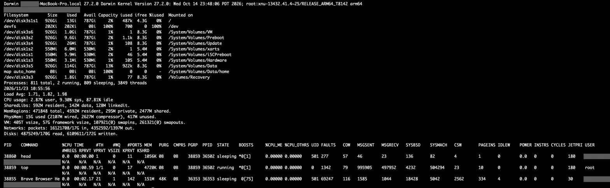

# Mission 3 - Operating System

# 1.Objective
My task was to use Terminal to look at my operating system, running processes, storage, paths and file permissions, and to explain what an operating system is responsible for.

# 2. Exploring the operating system
| Information explored | Command | What it tells me | My observation (privacy-safe) |
|---|---|---|---|
| Operating system details | `uname -a` | macos version | It printed Darwin, then a version number, then the chip type. The device name was my Mac's name, which I hid for privacy |
| Current account identity | `whoami` | current account name | It printed my account name, which I hid for privacy |
| Available and used storage | `df -h` | storage availability | The main disk showed about half used and about half free |
| System activity snapshot | `top -l 1 \| head -15` | view of running process | The top lines showed CPU and memory usage and a list of busy processes |

# 3. Processes

A process is a program that is running right now.

The PID is the unique number the OS gives each process so it can be identified.

Two examples of processes on my computer:
Finder and Terminal.

# 4. Paths and permissions
Absolute path vs relative path, with one example of each from my folder:
- Absolute path starts from the root `/`: `/Users/<my-username>/Desktop/digital-detective-8079/mission-03-operating-system/README.md`
- Relative path starts from the current folder: `mission-03-operating-system/README.md`

Permissions of one file in my practice area (owner can read, write, execute?):
README.md shows `-rw-r--r--`. The owner can read and write but cannot execute.

# 5. Operating system responsibilities
| Responsibility | My explanation | Example |
|---|---|---|
| Process management | scheduling and stopping running process | shares cpu time b/w a browser and text editor|
| Memory management | allocates the working memory | gives a app temporary memory|
| Device management | co-ordinates communication with hardware | sends a print job to printer  |
| File management | Stores and organises files and folders. | saves a document in a choosen folder |
| User interface or shell | Lets me interact with the computer. | respond to a terminal |
| Security and permissions | Controls who can access or change things. | resticts who can edit a file |

# 6. Commands used
- `uname -a`
- `whoami`
- `df -h`
- `top -l 1 | head -15`
- `ls -l`

# 7. My understanding
The OS manages processes, memory, devices, files and security so the computer works smoothly. These commands let me see it in action.

# 8. Difficulties faced

I encountered the new commands such as df, uname, and explored about their properties and functions. In the first it's difficult to read the output after this new commands.

# 9. How I resolved them

I researched and talked with my friends how exactly this commands and why we're using in our daily work life. I used the help of google and ai to explore the not known parts.

# 10. Evidence

# 11 Commit details

The commit details were Document operating system and file management and again found the small gaps in readme. Updated it and committed and pushed to the Github..